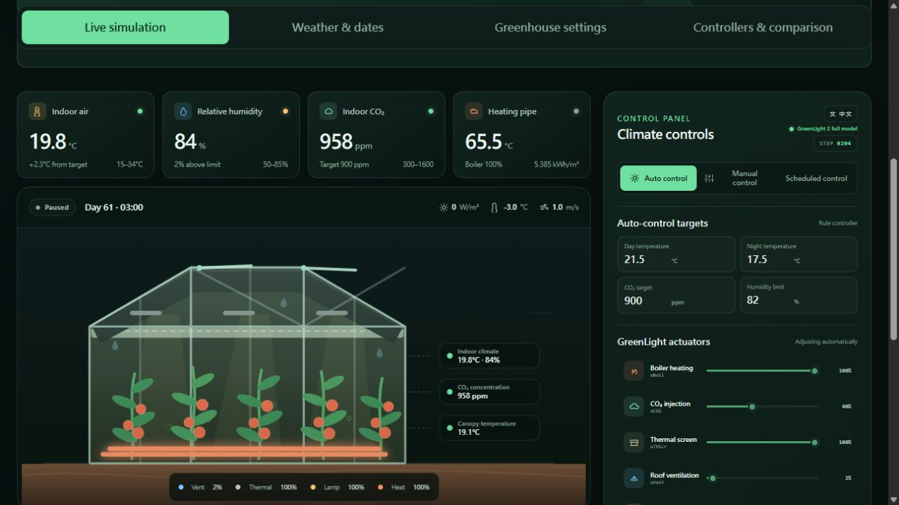
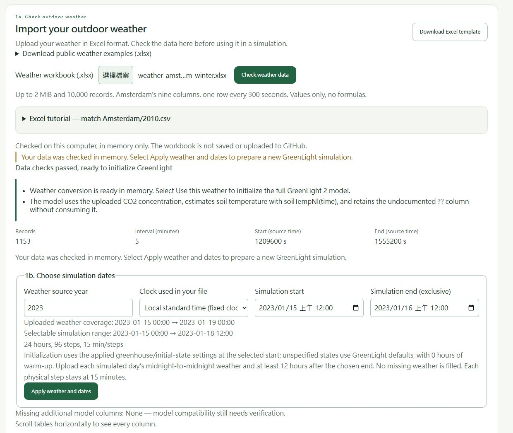
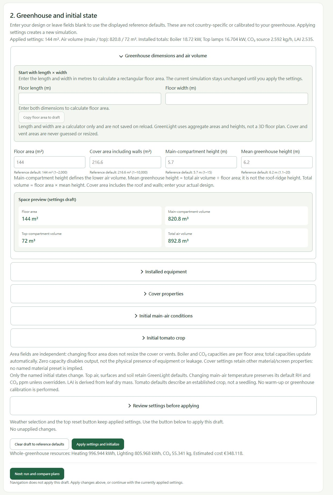
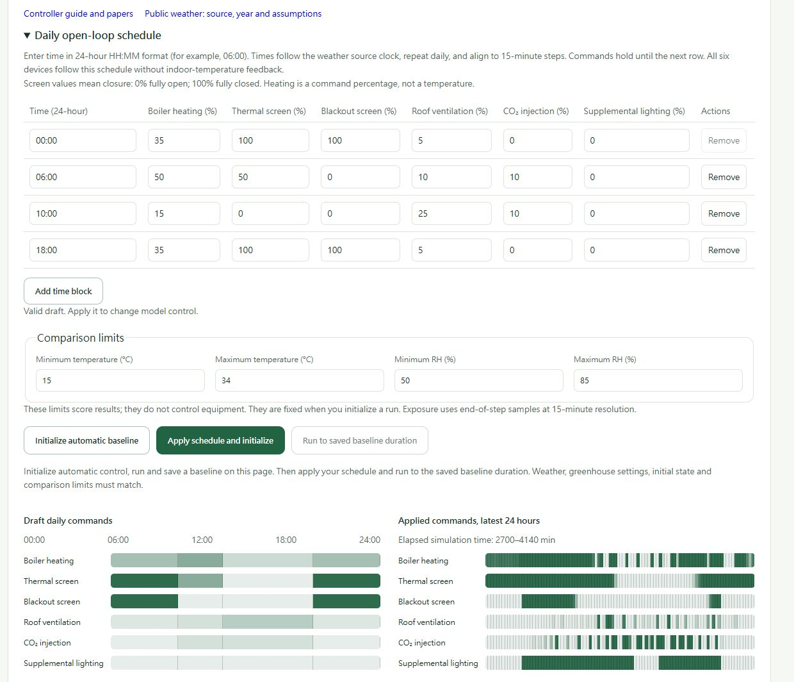

# GreenLight 2 Greenhouse Simulator

A dashboard for the GreenLight-Gym2 greenhouse model. Upload your local weather from Excel, adjust the greenhouse settings, and see how temperature, humidity and crop conditions change. Available in English and Chinese.



*The dashboard running GreenLight-Gym2 with Amsterdam weather. The drawing shows what the equipment and crop are doing; it is not a 3D simulation. Click any screenshot to see it at full size.*

[](https://github.com/benbenbeatit912002/Greenlight-simulation/actions/workflows/ci.yml)

**Still in development:** intended for learning and research, not production decisions. All simulation results come from the full GreenLight model; results are hidden if it is unavailable. Accuracy has not been independently validated. Greenhouse calibration and full time-series export are not yet available.

## A look at the dashboard

### 1. Upload local weather and choose simulation dates



Upload an Excel weather file using the provided template, check the data, and choose when to start and stop the simulation. You can also try the included weather examples for Amsterdam, Almería and Taipei.

### 2. Set up your greenhouse



Enter the greenhouse size, equipment capacities and starting air and crop conditions. Leave fields blank to use the model defaults. Nothing changes in the current run until you apply your settings.

### 3. Try an equipment schedule



Choose when to heat, ventilate, use the lights, add CO₂, or open and close the screens. Compare your schedule with automatic control using the same weather, greenhouse settings and run length. See the differences in temperature, humidity, heating energy and time outside your chosen limits.

## Dashboard pages

The dashboard has four pages:

- **Live simulation** — watch the greenhouse and adjust its controls.
- **Weather & dates** — upload weather and choose the simulation dates.
- **Greenhouse settings** — enter the size, equipment and starting conditions.
- **Controllers & comparison** — set equipment schedules and compare results.

You can switch pages without losing the current run or unsaved settings. The drawing is an illustration; the numbers come from the full GreenLight model. See the [user guide](docs/user-guide.md) for details.

## Acknowledgements and citation

The greenhouse model comes from **GreenLight**, developed by **David Katzin and collaborators**, and the **GreenLight-Gym2** implementation by **Bart van Laatum and contributors**.

- **Original GreenLight model:** David Katzin, Simon van Mourik, Frank Kempkes, and Eldert J. van Henten (2020). *GreenLight – An open source model for greenhouses with supplemental lighting: Evaluation of heat requirements under LED and HPS lamps*. Biosystems Engineering, 194, 61–81. [Paper](https://doi.org/10.1016/j.biosystemseng.2020.03.010) · [Original repository](https://github.com/davkat1/GreenLight).
- **GreenLight-Gym / GreenLight-Gym2:** Bart van Laatum, Eldert J. van Henten, and Sjoerd Boersma (2025). *GreenLight-Gym: Reinforcement learning benchmark environment for control of greenhouse production systems*. IFAC-PapersOnLine, 59(23), 437–442. [Paper](https://doi.org/10.1016/j.ifacol.2025.11.827) · [Upstream repository](https://github.com/BartvLaatum/GreenLight-Gym2).

This project adds the dashboard, weather uploads, settings and schedule comparisons. See [CITATION.md](CITATION.md) for upstream references and BibTeX.

## Quick start

Install Git, Python 3.12 and [uv](https://docs.astral.sh/uv/getting-started/installation/), then:

```sh
git clone https://github.com/benbenbeatit912002/Greenlight-simulation.git
cd Greenlight-simulation
uv sync --locked --extra greenlight --python 3.12 --cache-dir .uv-cache
uv run --no-sync python -B server.py --check-model
uv run --no-sync python -B server.py
```

Open <http://127.0.0.1:4173/>. Stop with Ctrl+C. The setup installs **gl-gym 0.3.2** and its dependencies into `.venv`, including the upstream Amsterdam example weather. You do not need a separate GreenLight checkout, a personal research folder or Node.js to run the simulator. The check command initializes the full model and runs one 15-minute step without starting a server.

See [the Windows/Linux/macOS installation guide](docs/installation.md) for project-local Python provisioning, interface-only use and advanced source overrides. If you previously set `GREENLIGHT_GYM_PATH`, unset it to use the installed package; explicit source paths take priority. Installation needs an internet connection; normal model runs do not.

## What you can do

- Use English or Traditional Chinese controls and explanations.
- Validate an Excel weather workbook, select source-clock simulation dates and review supported ranges.
- Configure supported greenhouse dimensions, equipment and initial conditions.
- Run the full model with automatic, manual or scheduled open-loop controls at fixed 15-minute steps.
- Edit a daily six-actuator schedule and inspect planned/applied equipment timelines.
- Compare compatible runs at matching horizons using whole-run climate, heating energy and time-outside-limit metrics.
- Try three attributed NASA POWER weather workbooks for Amsterdam, Almería and Taipei. See [public weather examples and limitations](docs/public-weather-examples.md).
- Download a two-year hourly [weather collection for eight locations](data/weather/README.md), with source records and quality checks. These are outdoor inputs, not greenhouse calibration data.

See the [scheduled control guide and research references](docs/controller-schedules.md) for the baseline-comparison workflow. The included schedule is a teaching example, not an optimized or safe growing strategy.

Each server process owns one shared simulation. For independent work, different users run separate local instances. This release is not a hosted multi-user service or production greenhouse controller.

## Find the right guide

| Goal | Read |
| --- | --- |
| Install on another computer | [Installation and troubleshooting](docs/installation.md) |
| Operate the interface | [User guide](docs/user-guide.md) |
| Run the public example | [Synthetic example](examples/README.md) |
| Prepare weather or settings | [Weather input](docs/weather-input.md), [greenhouse configuration](GREENHOUSE_CONFIGURATION.md) |
| Understand or modify code | [Architecture](docs/architecture.md), [contributing](CONTRIBUTING.md) |
| Call the local API | [API contract](docs/api.md) |
| Interpret scientific results | [Model card](MODEL_CARD.md), [validation](docs/scientific-validation.md) |
| Prepare local calibration | [Weather collection](data/weather/README.md), [methods and synthetic experiment](docs/calibration.md) |
| See planned capabilities | [Roadmap](docs/roadmap.md) |

## Repository map

```text
server.py           Stable local startup entry point
backend/            HTTP, application operations and scientific adapter
frontend/           Browser controls, translations, charts and upload UI
index.html          Public page and explicit browser-script load order
styles.css          Interface styling
docs/               Installation, user, architecture and scientific guides
examples/           Public validation example and expected summary
templates/          Excel weather template and three public weather examples
data/weather/       Weather collection instructions, site list and local downloads
tests/              Software contracts and opt-in full-model integration
scripts/check.py    Shared local/CI quality-check entry point
CHANGELOG.md        User-facing updates
```

## Contributing and checks

After the Python setup, install Node.js 22+ for development:

```sh
npm ci --ignore-scripts --cache .npm-cache
uv run --no-sync python -B scripts/check.py
```

Checks include Ruff formatting/lint/complexity, Prettier formatting, JavaScript syntax, Python and JavaScript contracts, and the public example. The default local checks skip model integration; CI also installs the pinned package and runs the separate full-model suite. These checks do not establish scientific accuracy. See [CONTRIBUTING](CONTRIBUTING.md) before submitting a focused pull request. Report sensitive issues through [SECURITY](SECURITY.md).

## Model provenance and license status

GreenLight-Gym2 supplies the scientific model; this repository supplies the local interface and adapter. Model attribution and references are in [CITATION.md](CITATION.md) and [MODEL_CARD](MODEL_CARD.md). Source, parameter and weather fingerprints help explain which model/configuration produced a run.

The [upstream gl-gym package](https://pypi.org/project/gl-gym/0.3.2/) declares **AGPL-3.0-or-later**. Its source, license and example weather are installed as a dependency, not copied into this repository. Installing it separately does not remove applicable upstream license obligations.

This dashboard does not yet have a software license. Public visibility alone does not grant permission to redistribute its code. The upstream model and weather data have their own terms.

## Updates

See the [changelog](CHANGELOG.md) for recent updates and the [roadmap](docs/roadmap.md) for planned features.
