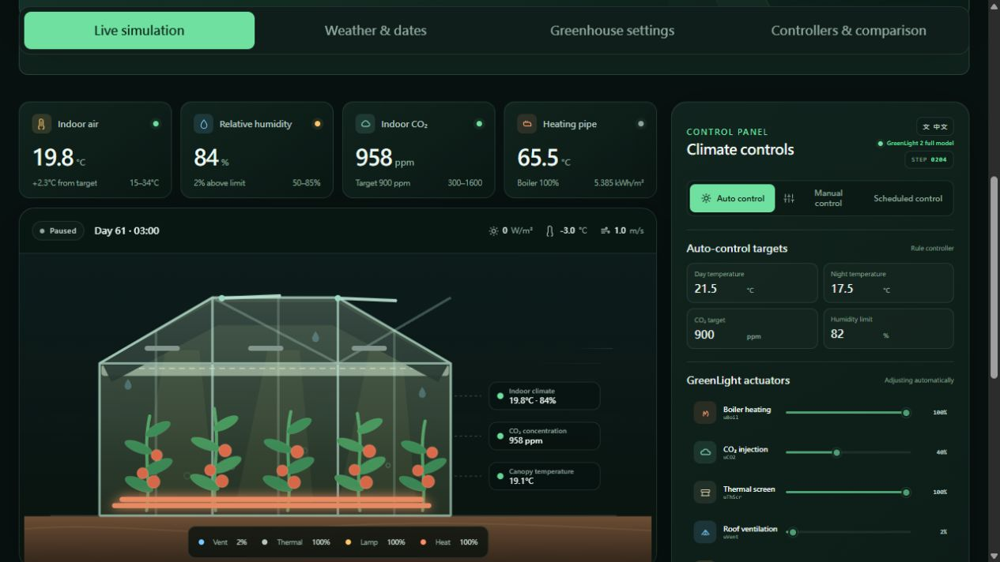
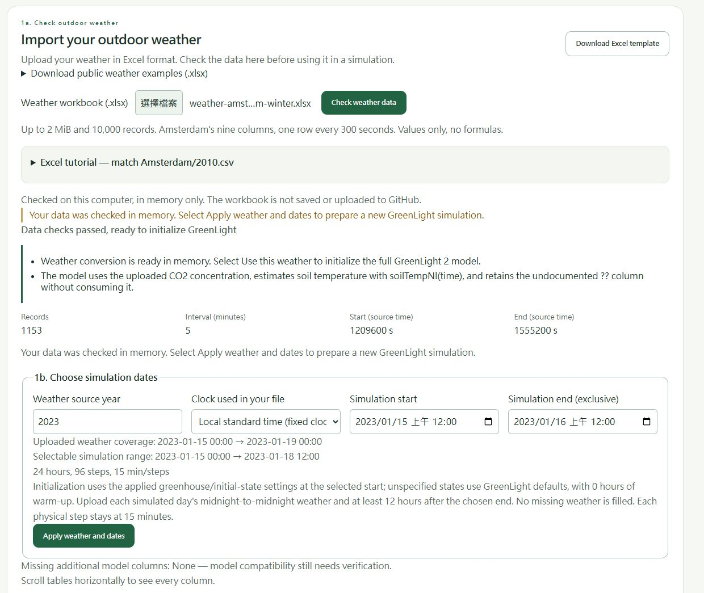
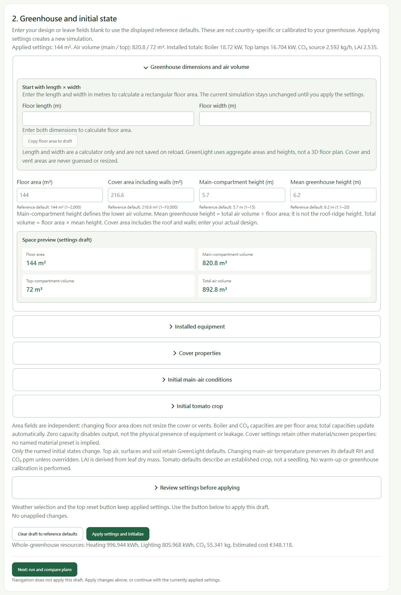
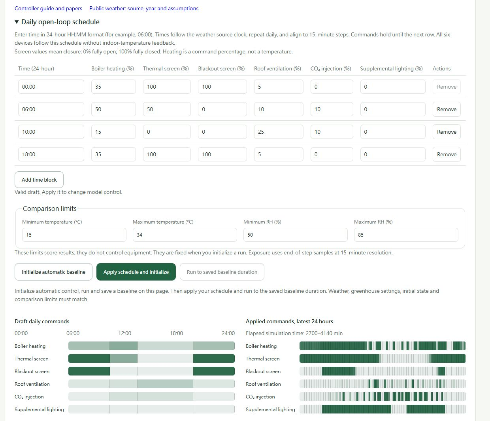

# GreenLight 2 Greenhouse Simulator

A dashboard for the GreenLight-Gym2 greenhouse model. Upload local weather from Excel, adjust the greenhouse settings, and see how temperature, humidity and crop conditions change. Available in English and Traditional Chinese.



*The dashboard running GreenLight-Gym2 with the bundled Amsterdam weather. The drawing illustrates equipment and crop states; it is not a 3D simulation. Click a screenshot to see it at full size.*

[](https://github.com/benbenbeatit912002/Greenlight-simulation/actions/workflows/ci.yml)

**Still in development:** intended for learning and research, not production decisions. All simulated responses come from the full GreenLight model. You can export and replay a run; weather uploads do not calibrate the model, and no locally validated parameter set is supplied.

## Quick start

Install Git, Python 3.12 and [uv](https://docs.astral.sh/uv/getting-started/installation/), then:

```sh
git clone https://github.com/benbenbeatit912002/Greenlight-simulation.git
cd Greenlight-simulation
uv sync --locked --extra greenlight --python 3.12 --cache-dir .uv-cache
uv run --no-sync python -B server.py --check-model
uv run --no-sync python -B server.py
```

Open <http://127.0.0.1:4173/>. Stop the server with Ctrl+C.

Setup installs **gl-gym 0.3.2** and its Amsterdam example weather into `.venv`. You do not need a separate model checkout or Node.js to run the dashboard. Installation needs an internet connection; normal simulation runs work offline. The check command initializes the full model and runs one 15-minute step without starting a server.

See [installation and troubleshooting](docs/installation.md) for Windows, Linux and macOS instructions. If you previously set `GREENLIGHT_GYM_PATH`, unset it to use the installed package.

## What you can try

### 1. Upload weather and choose dates



Use the Excel template to upload weather, check the available dates, and choose a simulation window. The included examples cover Amsterdam, Almería and Taipei. Indoor measurements are not required, but uploading weather does not calibrate the model to a new location.

### 2. Set up your greenhouse



Enter the greenhouse size, equipment capacities and starting air and crop conditions. Blank fields use model defaults. Your edits take effect only when you apply them.

### 3. Compare equipment controls



Choose when to heat, ventilate, use lights, add CO₂, or open and close the screens. Compare your schedule with automatic control using the same weather, greenhouse settings and run length. Review temperature, humidity, heating energy and time outside your chosen limits together.

To try [model predictive control (MPC)](docs/controller-schedules.md#select-equipment-for-mpc), open **Run & compare** and select the devices it can adjust. For example, give MPC heating and roof ventilation, and leave the screens, lights and CO₂ to the usual rules. Leave all six unchecked for a rule-based run.

The **Live simulation** page shows the running model. Pause either run and download its settings and complete 15-minute time series from **Run & compare**. The [user guide](docs/user-guide.md#save-and-reproduce-a-run) explains how someone else can reproduce it with the same weather.

**Try the Taipei comparison.** After the quick start, run these commands from the project folder. Both schedules turn heating off at 08:00; one starts at 04:00 and the other at 06:00. The example uses the same greenhouse and 48 hours of Taipei weather for both. Choose a new output directory each time.

```sh
uv run --no-sync python -B examples/taipei_heating_replay.py --save-dir outputs/taipei-demo
uv run --no-sync python -B scripts/replay_run.py outputs/taipei-demo/0400.zip --weather templates/weather-taipei-summer.xlsx
uv run --no-sync python -B scripts/replay_run.py outputs/taipei-demo/0600.zip --weather templates/weather-taipei-summer.xlsx
```

Each replay prints the number of verified 15-minute steps and the regenerated CSV checksum. See `summary.json` in the output directory to compare heating use with hours outside the chosen temperature and humidity limits.

## Before interpreting the results

- Weather is an input, not evidence that the model matches a particular greenhouse. Unspecified settings use reference defaults.
- The physical timestep stays at 15 minutes. Playback speed only changes how quickly steps are requested.
- Comparisons require matching weather, model version, greenhouse configuration, initial state and duration. A saved result from an older model may need to be replaced.
- The example schedule is not an optimized growing strategy. Lower heating use can come with unsuitable temperature or humidity.
- Each server has one shared simulation. Use separate local instances for independent runs; this is not a hosted multi-user service.
- If the full model is unavailable or fails, simulation results are hidden. There is no simplified-model fallback.

The [model notes](MODEL_CARD.md) explain assumptions, numerical test results and remaining limitations.

## Guides and examples

| What you need | Guide |
| --- | --- |
| Use the dashboard | [User guide](docs/user-guide.md) |
| Prepare an Excel file | [Weather format](docs/weather-input.md) and [public examples](docs/public-weather-examples.md) |
| Understand greenhouse inputs | [Configuration reference](GREENHOUSE_CONFIGURATION.md) |
| Set a daily control schedule | [Schedules and comparison](docs/controller-schedules.md) |
| Run a small installation example | [Synthetic workbook check](examples/README.md) |
| Collect weather from more locations | [NASA POWER collection](data/weather/README.md) |
| Understand calibration | [Measurements and fitting example](docs/calibration.md) |
| Read or change the code | [Architecture](docs/architecture.md), [local API](docs/api.md) and [contributing](CONTRIBUTING.md) |

See the [changelog](CHANGELOG.md) for updates and the [roadmap](docs/roadmap.md) for planned work. For sensitive reports, read [SECURITY.md](SECURITY.md).

## Model provenance and license status

The greenhouse model comes from **GreenLight**, developed by **David Katzin and collaborators**, and the **GreenLight-Gym2** implementation by **Bart van Laatum and contributors**. This project adds the dashboard, weather uploads, greenhouse settings and schedule comparisons. It does not claim authorship of the scientific model.

- Katzin, van Mourik, Kempkes and van Henten (2020), *GreenLight – An open source model for greenhouses with supplemental lighting: Evaluation of heat requirements under LED and HPS lamps*. [Paper](https://doi.org/10.1016/j.biosystemseng.2020.03.010), [original repository](https://github.com/davkat1/GreenLight).
- van Laatum, van Henten and Boersma (2025), *GreenLight-Gym: Reinforcement learning benchmark environment for control of greenhouse production systems*. [Paper](https://doi.org/10.1016/j.ifacol.2025.11.827), [upstream repository](https://github.com/BartvLaatum/GreenLight-Gym2).

Full references and BibTeX are in [CITATION.md](CITATION.md).

Copyright (C) 2026 Hao Yu Liu and contributors. The original dashboard and integration code, tests and documentation are licensed under **AGPL-3.0-or-later**, except where different terms are identified. You may use, modify and share them under those terms. The software is provided without warranty. See [LICENSE](LICENSE).

The [upstream gl-gym package](https://pypi.org/project/gl-gym/0.3.2/) also declares **AGPL-3.0-or-later**. Its source, license and weather are installed as a dependency; separate installation does not remove applicable upstream license obligations. Weather data and other third-party material retain their own terms.

See [software and data notices](THIRD_PARTY_NOTICES.md) for upstream sources, the pinned model source archive and guidance on sharing or hosting a modified version. A hosted modified version must offer the corresponding source required by AGPL; keep its Source code link matched to the version users run.
